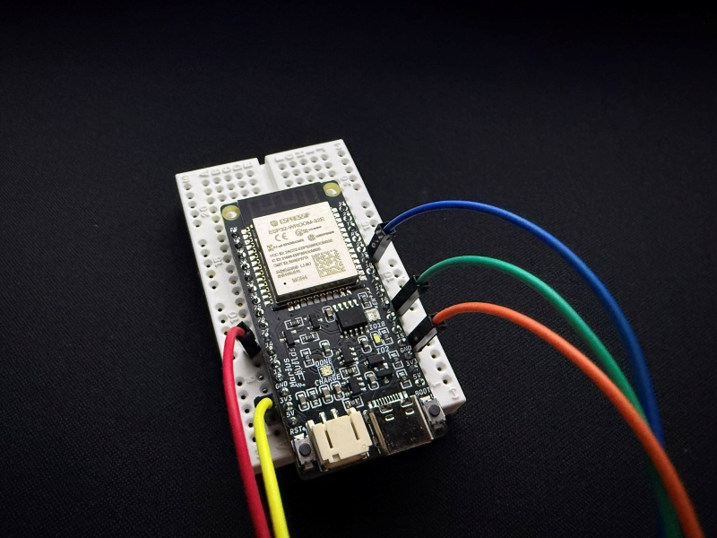
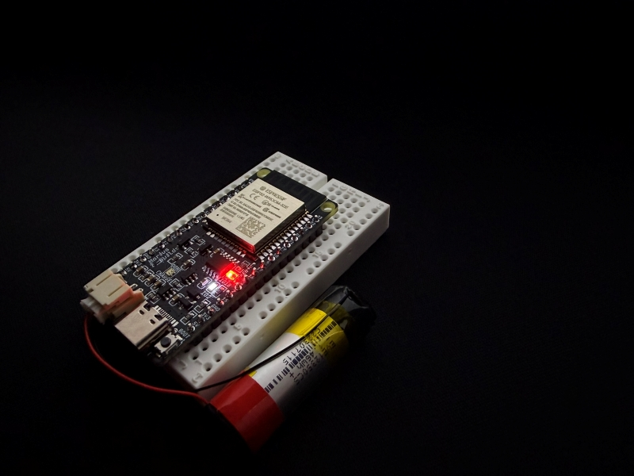
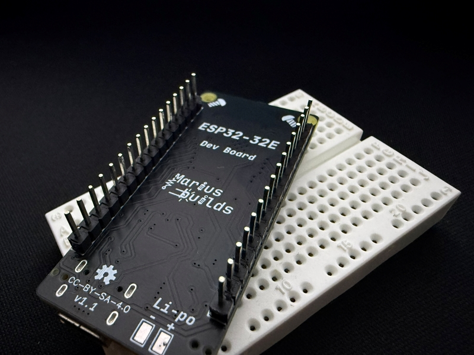

# ESP32-WROOM-32E DevBoard

The classic ESP32 DevKitC, minus everything that annoys me about it. USB-C instead of micro-USB, LiPo charging built in, auto-reset, an RGB LED, and – most importantly – a width that leaves **free rows on both sides of the breadboard**. Because one row of holes per side is not "breadboard friendly", it's a hostage situation.

<p align="center">
  
</p>

## Why another ESP32 dev board? 🤔

The DevKitC is great, until you actually use it:

- **It's too wide.** Plug it into a breadboard and you're left with exactly one row of holes on each side for your wires. Good luck.
- **Micro-USB.** In this economy.
- **No battery support.** Want it portable? Enjoy your extra charger module, extra wires and extra regrets.

So I made my own.

## MAIN FEATURES :

- **ESP32-WROOM-32E (4MB)** – the same dual-core Wi-Fi + Bluetooth brain you know and love.
- **USB-C** – with proper 5.1kΩ CC resistors, so even C-to-C cables and picky chargers will play along.
- **CH340K USB-to-serial + auto-reset circuit** – hit Upload and walk away. No more BOOT-button finger gymnastics.
- **BOOT and RESET buttons** – for when you *do* want the finger gymnastics.
- **Li-Po / Li-ion charging** – **TP4057** charger, PH2.0 connector (plus B+ / B− solder pads), and a **dual-color status LED** that tells you if it's charging or done.
- **Automatic power path** – a P-MOSFET + Schottky diode switch between USB and battery on their own. Plug in, unplug, the board doesn't even notice.
- **XC6210 700mA LDO** – plenty of headroom for Wi-Fi bursts and that one extra module you swore you wouldn't add.
- **WS2812B-2020 RGB LED** on IO18 – status indicator, mood light, or very small disco. Behind a solder bridge, so you can have IO18 back if you need it.
- **User LED on IO2** – for the classic blink sketch. Every board needs one, it's the law.
- **2 × 16-pin headers, breadboard friendly** – leaves free rows on **both** sides. Your jumper wires can finally breathe.
- **Two mounting holes** – for when the project graduates from the breadboard.

<p align="center">
  
  
</p>

## Pinout 📌

| Left header | | Right header |
|---|---|---|
| 1 – EN | | 1 – IO23 |
| 2 – SENSOR_VP (IO36) | | 2 – IO22 |
| 3 – SENSOR_VN (IO39) | | 3 – TXD0 |
| 4 – IO34 | | 4 – RXD0 |
| 5 – IO35 | | 5 – IO21 |
| 6 – IO32 | | 6 – IO19 |
| 7 – IO33 | | 7 – IO18 (RGB LED) |
| 8 – IO25 | | 8 – IO5 |
| 9 – IO26 | | 9 – IO17 |
| 10 – IO27 | | 10 – IO16 |
| 11 – IO14 | | 11 – IO4 |
| 12 – IO12 | | 12 – IO2 (user LED) |
| 13 – IO13 | | 13 – IO15 |
| 14 – GND | | 14 – GND |
| 15 – 3V3 | | 15 – 3V3 |
| 16 – 5V (USB) | | 16 – 5V (USB) |

**Good to know:**
- **IO34, IO35, IO36 (VP) and IO39 (VN) are input-only** – no outputs, no internal pull-ups. That's the ESP32, not me.
- **IO0, IO2, IO12 and IO15 are strapping pins** – be careful what you connect to them, or the board may refuse to boot. IO12 in particular must not be pulled HIGH at boot.
- **The 5V pin is USB power only.** When running on battery there's no 5V on it – the board runs everything from the battery through the 3.3V LDO.

## IMPORTANT INFORMATIONS ! ⚠️

1. **Close solder bridge SB1 to use the RGB LED.** It's open by default, so IO18 stays free for whatever you have in mind. If your LED stays dark, this is why. Probably.

2. **Install the CH340 driver** before plugging the board in, otherwise your computer will politely pretend nothing is connected. Windows: https://www.wch-ic.com/downloads/CH341SER_EXE.html · macOS: https://www.wch-ic.com/downloads/CH34XSER_MAC_ZIP.html · Linux: already has it, as Linux likes to remind everyone.

3. **In Arduino IDE** select **ESP32 Dev Module** from the ESP32 board package, with **Flash Size → 4MB**. Thanks to the auto-reset circuit you just press Upload – no buttons needed.

4. **Check battery polarity before connecting!** PH2.0 battery connectors are *not* standardized, and plenty of batteries come with the wires the "wrong" way around. Compare with the markings on the PCB and swap the pins in the plug if needed.

5. **Single-cell 3.7V Li-Po / Li-ion only.** The TP4057 charges to 4.2V, so no 2S packs and no LiFePO4.

6. **Use a stencil when assembling** – it makes life a lot easier with the CH340K and the small SOT-23 parts.

## Quick test 🧪

The **SKETCH** folder has a quick test that blinks the user LED on IO2, cycles the RGB LED and says hello over Serial (115200 baud). It needs the **Adafruit NeoPixel** library.

```cpp
#include <Adafruit_NeoPixel.h>

#define USER_LED 2
#define RGB_PIN  18

Adafruit_NeoPixel rgb(1, RGB_PIN, NEO_GRB + NEO_KHZ800);

void setup() {
  Serial.begin(115200);
  pinMode(USER_LED, OUTPUT);
  rgb.begin();
  rgb.setBrightness(40);  // it's a 2020 LED, not a stadium floodlight
}

void loop() {
  const uint32_t colors[] = { rgb.Color(255, 0, 0), rgb.Color(0, 255, 0), rgb.Color(0, 0, 255) };
  for (uint32_t c : colors) {
    digitalWrite(USER_LED, !digitalRead(USER_LED));
    rgb.setPixelColor(0, c);
    rgb.show();
    delay(500);
  }
}
```

Red, green, blue and a blinking user LED? The board works. Nothing? Check SB1. Still nothing? The board works and the code is lying.

## Main components 🔩

| Part | Component | LCSC |
|---|---|---|
| MCU | ESP32-WROOM-32E-N4 | [C701341](https://www.lcsc.com/product-detail/C701341.html) |
| USB-to-serial | CH340K | [C968586](https://www.lcsc.com/product-detail/C968586.html) |
| LDO 3.3V / 700mA | XC6210B332MR-G | [C47719](https://www.lcsc.com/product-detail/C47719.html) |
| Battery charger | TP4057 | [C12044](https://www.lcsc.com/product-detail/C12044.html) |
| Power path MOSFET | DMG3415UQ-7 | [C459537](https://www.lcsc.com/product-detail/C459537.html) |
| Schottky diode | NSR0320MW2T1G | [C48192](https://www.lcsc.com/product-detail/C48192.html) |
| Auto-reset transistors (x2) | L8050QLT1G | [C49581](https://www.lcsc.com/product-detail/C49581.html) |
| USB-C connector | GT-USB-7010ASV | [C2988369](https://www.lcsc.com/product-detail/C2988369.html) |
| Battery connector | PH2.0 2P SMD | [C47647](https://www.lcsc.com/product-detail/C47647.html) |
| RGB LED | WS2812B-2020 | [C965555](https://www.lcsc.com/product-detail/C965555.html) |
| Charging status LED | Everlight 19-223/R6BHC-A05/2T | [C131286](https://www.lcsc.com/product-detail/C131286.html) |
| Buttons (x2) | TSA343G00D-250J2 | [C354947](https://www.lcsc.com/product-detail/C354947.html) |

Full BOM in the **GERBER, BOM, PNP** folder.

**Out of stock? No problem.** The schematic also lists drop-in alternatives (not in the BOM): **AO3401A** for the P-MOSFET, **1N5819HW** for the Schottky diode, and **S8050** / **2N3904** for the auto-reset transistors.

## Repository content 📂

- **GERBER, BOM, PNP** – everything needed to order the PCB (and assembly) from JLCPCB or your favorite fab.
- **SCHEMATIC** – the schematic.
- **SKETCH** – the quick test sketch.
- **Images** – photos and renders.

## Status ✅

Assembled and tested. Which, in hardware, is basically a miracle worth documenting.

## If you want to edit the PCB

**Project can also be found here:** https://oshwlab.com/mariusmym/PROJECT-LINK-HERE

## License 📜

[](https://creativecommons.org/licenses/by-sa/4.0/)

This project is licensed under [Creative Commons Attribution-ShareAlike 4.0 International](https://creativecommons.org/licenses/by-sa/4.0/).

In human words:
- ✅ **Share** – copy and redistribute it in any medium or format
- ✅ **Adapt** – remix, transform, and build upon it
- 🏷️ **Attribution** – give credit and link back here
- 🔁 **ShareAlike** – if you remix it, share your version under the same license

## Donate ☕

If you'd like to say thanks or buy me a coffee, a **[PayPal donation](https://www.paypal.com/donate/?hosted_button_id=KHR7DYJP2Z8QJ)** is always appreciated!

Have fun and enjoy it ! 😊
